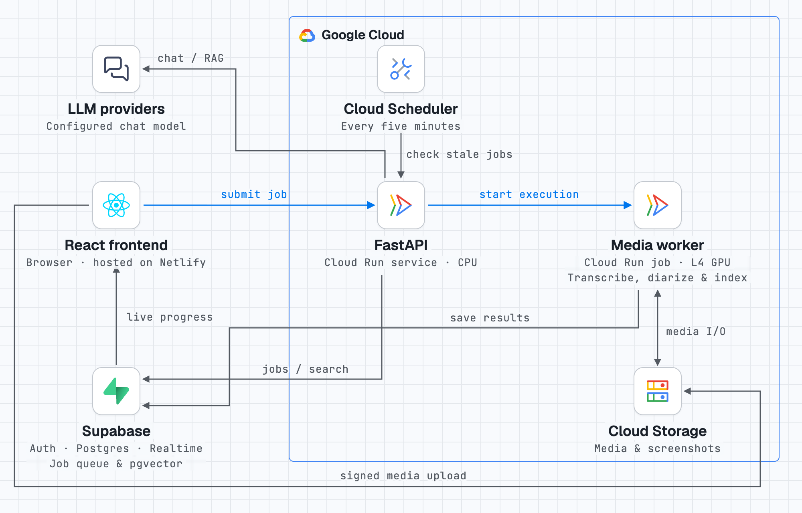

# AI Subtitles

AI video transcription with speaker diarization, multimodal search (transcript, visuals, audio, faces), and RAG-powered chat. Heavy processing runs on a Cloud Run GPU job; the API stays on a cheap CPU service.


## Features

### Available now

**Processing (GPU worker)**
- **Transcription** - faster-whisper on an L4 GPU. Each upload uses `large-v3` (Accurate, the default) or `large-v3-turbo` (Fast). Local mode uses `small` on CPU. The language is detected automatically, or you can set it.
- **Speaker diarization** - pyannote, which processes recordings longer than 30 minutes in chunks and links speakers across chunks. Speaker count is detected automatically.
- **Translation** - MarianMT translates non-English transcripts to English.
- **Screenshots and visual index** - A frame for each segment plus dense frames every 10 seconds, embedded with CLIP and captioned by a vision model (xAI)
- **Faces** - Faces are detected with InsightFace (ArcFace). Each person is indexed across the video.
- **Audio events** - PANNs detects laughter, applause, music and other sounds, plus energy levels.
- **Media formats** - MP4, MP3, WAV, WebM, MKV and more, with resumable uploads straight to GCS

**In the app**
- **Transcript view** - Synced video player, speaker filter, jump to a timestamp, and renaming speakers
- **Speaker recognition** - Enroll a voiceprint, then identify that speaker automatically in new videos.
- **Face tagging** - Tag a face with a speaker name so search and chat can find that person.
- **RAG chat** - Streaming answers grounded in a single video. Retrieval combines transcript text (semantic and lexical), visual scenes (CLIP and captions), face identity, audio events and speaker context. Answers include timestamp links, source screenshots and suggested questions.
- **Person comparison** - In chat, compare one person's appearances side by side on a timeline. You can swap in other moments.
- **Subtitle export** - SRT and WebVTT, original or translated
- **Job library** - Live progress through Supabase Realtime, plus cancel, retry, delete and share links (read-only and token-based)
- **Multiple LLMs** - Grok (default), Groq, OpenAI, Anthropic, DeepSeek, or Ollama (local), with your own API keys stored encrypted per user

**Accounts and operations**
- **Auth** - Email and password with a cookie session, invite-code registration, email verification and password reset
- **Plans and quotas** - Free (60 min/month, 30 min per file, no chat), Pro (15 h/month, 3 h per file) and Studio (50 h/month, 6 h per file), with a concurrency cap per plan. Admins are exempt.
- **Billing** - Stripe Checkout, the customer portal and webhooks, plus a pricing page. Requires the `STRIPE_*` secrets; without them the billing routes return 503.
- **Admin dashboard** - Usage stats, user management and invite codes
- **Reliable long jobs** - Per-chunk checkpoints let multi-hour files resume across GPU runs. Jobs that go stale are re-dispatched automatically.

### Behind feature flags

These features are fully built but switched off unless enabled in [Flagsmith](https://flagsmith.com) (`FLAGSMITH_SERVER_KEY` on the backend). Without a key, or before the first successful fetch, every flag is **off**. While a flag is off, the UI hides the tab and the API returns `404`.

| Flag | Feature | API |
|------|---------|-----|
| `chapters` | Auto-generated chapters: semantic topic-shift detection with LLM-written titles, shown on the video timeline and in a Chapters tab | `/api/chapters/*` |
| `summary` | Section summaries with screenshots (local BART model), shown in a Summary tab | `POST /generate_summary/` |

The flag list lives in `backend/services/feature_flags.py` (`KNOWN_FLAGS`). The backend caches Flagsmith values for 15 minutes. The frontend reads them from `GET /api/features` and fails closed: tabs stay hidden while the flags load.

### Pipeline switches (environment)

Each pipeline stage can be turned off in `backend/config.py`. All of them are on by default: `ENABLE_SPEAKER_DIARIZATION`, `ENABLE_VISION_CAPTIONS`, `ENABLE_AUDIO_ANALYSIS`, `VAD_ENABLED`. See [docs/CONFIGURATION.md](docs/CONFIGURATION.md).

## Tech Stack

| Layer | Technologies |
|-------|-------------|
| **Frontend** | React 19, TypeScript, Vite, TailwindCSS, React Query, Supabase JS (Realtime) |
| **Backend** | FastAPI, faster-whisper, PyTorch, pyannote, sentence-transformers, pgvector |
| **Infrastructure** | Cloud Run (CPU service + L4 GPU job), Cloud Storage, Cloud Scheduler, Supabase (Postgres, Auth, Realtime), Netlify |

## Quick Start

### Prerequisites

- Node.js 18+, Python 3.9+, FFmpeg
- [HuggingFace token](https://huggingface.co/settings/tokens) (for speaker diarization)

### Backend

```bash
cd backend
python -m venv venv && source venv/bin/activate
pip install -r requirements.txt
cp .env.example .env  # Supabase credentials + LOCAL_MODE=true for running without GCS
uvicorn main:app --reload --port 8000
```

### Frontend

```bash
cd frontend
npm install
npm run dev
```

Open http://localhost:5173

## Architecture

<picture>
  <source media="(prefers-color-scheme: dark)" srcset="docs/images/architecture-dark.png">
  
</picture>

**Life of a job**

1. The browser uploads media and calls `POST /api/jobs/submit`; the API writes a `jobs` row to Supabase Postgres. That table is the queue.
2. The API starts one execution of the `ai-subs-worker` Cloud Run Job (`worker_main.py`) for that job, on an L4 GPU. The worker claims the row and sends a heartbeat every 30 seconds.
3. The worker transcribes in 5-minute chunks and checkpoints each one, then diarizes, extracts screenshots, computes embeddings, and translates. Media goes through GCS, results land in Supabase.
4. A GPU execution can run for at most one hour. If a file needs longer, the worker stops at a chunk boundary and starts a new execution for the same job, which resumes from the checkpoints.
5. Supabase Realtime pushes progress to the browser. Cloud Scheduler calls `check-stale` every 5 minutes to re-dispatch jobs whose worker died and to retry a timed-out job once.
6. Search and chat are served by the CPU API from pgvector, with answers generated by the configured LLM provider.

There is no Kubernetes cluster and no separate queue service; [docs/ARCHITECTURE.md](docs/ARCHITECTURE.md) explains why.

With `LOCAL_MODE=true`, GCS and the Cloud Run Job are replaced by local disk and a local subprocess. Supabase is still required.

## Troubleshooting

| Issue | Solution |
|-------|----------|
| `No module named 'torch'` | Activate venv: `source venv/bin/activate` |
| `FFmpeg not found` | Install: `brew install ffmpeg` (macOS) or `apt install ffmpeg` |
| Speaker diarization fails | Check `HUGGINGFACE_TOKEN` and [accept pyannote terms](https://huggingface.co/pyannote/speaker-diarization) |
| Ollama connection error | Start Ollama: `ollama serve` |
| Large file upload fails | Enable GCS: `ENABLE_GCS_UPLOADS=true` |

## Documentation

- [Configuration Guide](docs/CONFIGURATION.md) - All environment variables
- [API Reference](docs/API.md) - Complete endpoint documentation
- [Architecture](docs/ARCHITECTURE.md) - Detailed system diagrams
- [Speaker Diarization Setup](docs/SPEAKER_DIARIZATION_SETUP.md)
- [Deployment](backend/DEPLOYMENT.md) and [GCP Operations](docs/GCP_OPERATIONS.md) - Deploying, scheduler jobs, key rotation
- [Production Deployment Fixes](docs/PRODUCTION_DEPLOYMENT_FIXES.md) - Historical notes

## Project Structure

```
ai-subs/
├── frontend/          # React + TypeScript
│   ├── src/
│   │   ├── components/
│   │   ├── hooks/
│   │   ├── services/
│   │   └── types/
│   └── package.json
├── backend/           # FastAPI + ML
│   ├── routers/       # API endpoints
│   ├── services/      # Business logic
│   ├── middleware/    # Auth, CSRF, quota, rate limiting
│   ├── models/        # Pydantic schemas
│   ├── sql/           # Supabase schemas and migrations
│   ├── evals/         # Paid LLM evals (manual)
│   ├── worker_main.py # GPU worker entrypoint (Cloud Run Job)
│   ├── deploy.sh      # Builds and deploys service + worker
│   └── main.py        # API entrypoint
└── docs/              # Documentation
```

## Contributing

Contributions welcome! Please open issues or submit pull requests.

## Acknowledgments

[Faster Whisper](https://github.com/guillaumekln/faster-whisper) |
[Pyannote](https://github.com/pyannote/pyannote-audio) |
[Ollama](https://ollama.ai/) |
[CLIP](https://github.com/openai/CLIP) |
[PANNs](https://github.com/qiuqiangkong/audioset_tagging_cnn)
