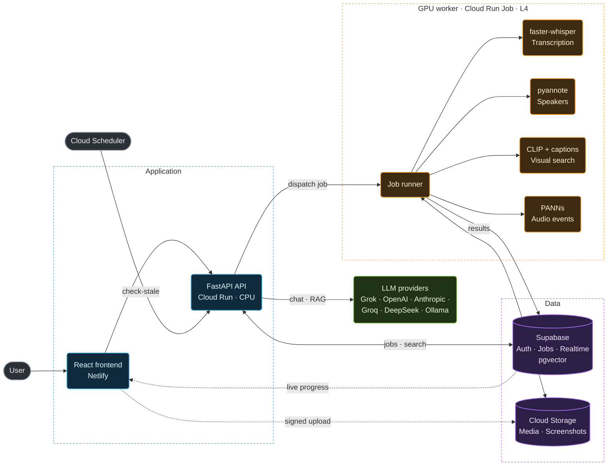

# AI Subtitles

AI video transcription with speaker diarization, multimodal search (transcript, visuals, audio, faces), and RAG-powered chat. Heavy processing runs on a Cloud Run GPU job; the API stays on a cheap CPU service.


## Features

- **GPU Transcription** - faster-whisper `large-v3` on an L4 GPU worker (`small` on CPU in local mode)
- **Speaker Diarization & Recognition** - Chunked pyannote diarization plus saved speaker voiceprints
- **Multi-format Support** - MP4, MP3, WAV, WebM, MKV, and more
- **Multi-language** - Auto-detection and translation using MarianMT
- **Semantic Search** - Transcript search by meaning with pgvector embeddings
- **Visual Search** - CLIP image embeddings plus vision-model captions, searchable by describing what you see
- **Face Tags** - Tag people and find where they appear
- **Audio Analysis** - Detect laughter, applause, music (PANNs) and speech emotion
- **Chapters** - Auto-generated chapters and summaries
- **RAG Chat** - Ask questions about your video with context-aware answers
- **Background Jobs** - Async processing with live progress via Supabase Realtime, automatic stale-job recovery, and per-chunk checkpoints so multi-hour files resume across worker runs
- **Accounts** - Cookie auth, invite codes, quotas/billing tiers, and bring-your-own LLM API keys
- **Share Links & Subtitle Export** - Public links; WebVTT and SRT with translation
- **Multiple LLMs** - Grok (default), Groq, OpenAI, Anthropic, DeepSeek, Ollama (local)

## Tech Stack

| Layer | Technologies |
|-------|-------------|
| **Frontend** | React 19, TypeScript, Vite, TailwindCSS, React Query, Supabase JS (Realtime) |
| **Backend** | FastAPI, faster-whisper, PyTorch, pyannote, sentence-transformers, pgvector |
| **Infrastructure** | Cloud Run (CPU service + L4 GPU job), Cloud Storage, Cloud Scheduler, Supabase (Postgres, Auth, Realtime), Netlify |

## Quick Start

### Prerequisites

- Node.js 18+, Python 3.9+, FFmpeg
- [HuggingFace token](https://huggingface.co/settings/tokens) (for speaker diarization)

### Backend

```bash
cd backend
python -m venv venv && source venv/bin/activate
pip install -r requirements.txt
cp .env.example .env  # Supabase credentials + LOCAL_MODE=true for running without GCS
uvicorn main:app --reload --port 8000
```

### Frontend

```bash
cd frontend
npm install
npm run dev
```

Open http://localhost:5173

## Architecture



**Life of a job**

1. The browser uploads media and calls `POST /api/jobs/submit`; the API writes a `jobs` row to Supabase Postgres. That table is the queue.
2. The API starts one execution of the `ai-subs-worker` Cloud Run Job (`worker_main.py`) for that job, on an L4 GPU. The worker claims the row and sends a heartbeat every 30 seconds.
3. The worker transcribes in 5-minute chunks and checkpoints each one, then diarizes, extracts screenshots, computes embeddings, and translates. Media goes through GCS, results land in Supabase.
4. A GPU execution can run for at most one hour. If a file needs longer, the worker stops at a chunk boundary and starts a new execution for the same job, which resumes from the checkpoints.
5. Supabase Realtime pushes progress to the browser. Cloud Scheduler calls `check-stale` every 5 minutes to re-dispatch jobs whose worker died and to retry a timed-out job once.
6. Search and chat are served by the CPU API from pgvector, with answers generated by the configured LLM provider.

There is no Kubernetes cluster and no separate queue service; [docs/ARCHITECTURE.md](docs/ARCHITECTURE.md) explains why.

With `LOCAL_MODE=true`, GCS and the Cloud Run Job are replaced by local disk and a local subprocess. Supabase is still required.

## Troubleshooting

| Issue | Solution |
|-------|----------|
| `No module named 'torch'` | Activate venv: `source venv/bin/activate` |
| `FFmpeg not found` | Install: `brew install ffmpeg` (macOS) or `apt install ffmpeg` |
| Speaker diarization fails | Check `HUGGINGFACE_TOKEN` and [accept pyannote terms](https://huggingface.co/pyannote/speaker-diarization) |
| Ollama connection error | Start Ollama: `ollama serve` |
| Large file upload fails | Enable GCS: `ENABLE_GCS_UPLOADS=true` |

## Documentation

- [Configuration Guide](docs/CONFIGURATION.md) - All environment variables
- [API Reference](docs/API.md) - Complete endpoint documentation
- [Architecture](docs/ARCHITECTURE.md) - Detailed system diagrams
- [Speaker Diarization Setup](docs/SPEAKER_DIARIZATION_SETUP.md)
- [Deployment](backend/DEPLOYMENT.md) and [GCP Operations](docs/GCP_OPERATIONS.md) - Deploying, scheduler jobs, key rotation
- [Production Deployment Fixes](docs/PRODUCTION_DEPLOYMENT_FIXES.md) - Historical notes

## Project Structure

```
ai-subs/
├── frontend/          # React + TypeScript
│   ├── src/
│   │   ├── components/
│   │   ├── hooks/
│   │   ├── services/
│   │   └── types/
│   └── package.json
├── backend/           # FastAPI + ML
│   ├── routers/       # API endpoints
│   ├── services/      # Business logic
│   ├── middleware/    # Auth, CSRF, quota, rate limiting
│   ├── models/        # Pydantic schemas
│   ├── sql/           # Supabase schemas and migrations
│   ├── evals/         # Paid LLM evals (manual)
│   ├── worker_main.py # GPU worker entrypoint (Cloud Run Job)
│   ├── deploy.sh      # Builds and deploys service + worker
│   └── main.py        # API entrypoint
└── docs/              # Documentation
```

## Contributing

Contributions welcome! Please open issues or submit pull requests.

## Acknowledgments

[Faster Whisper](https://github.com/guillaumekln/faster-whisper) |
[Pyannote](https://github.com/pyannote/pyannote-audio) |
[Ollama](https://ollama.ai/) |
[CLIP](https://github.com/openai/CLIP) |
[PANNs](https://github.com/qiuqiangkong/audioset_tagging_cnn)
