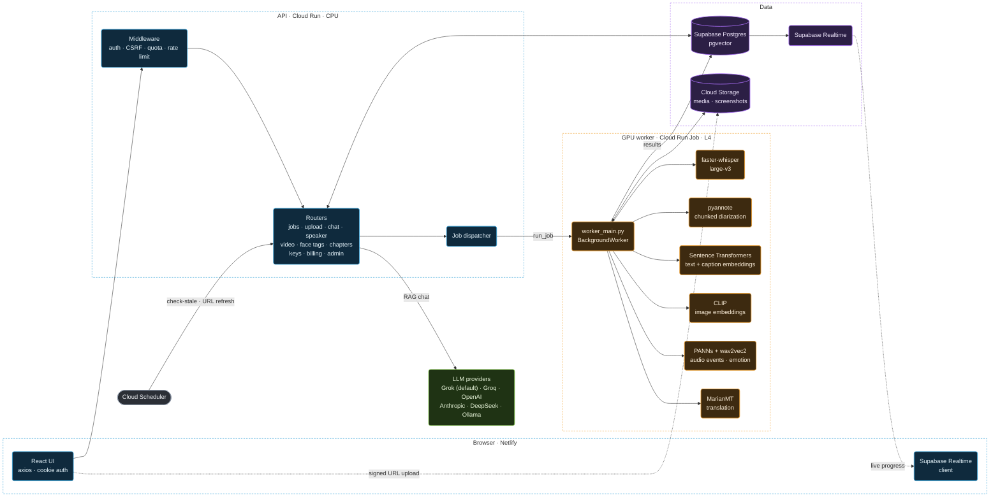
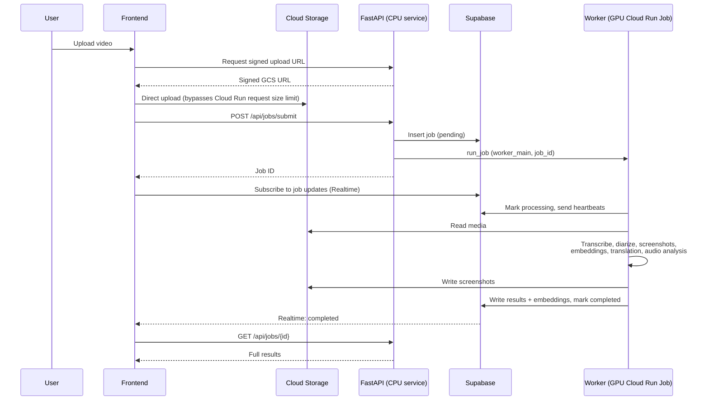
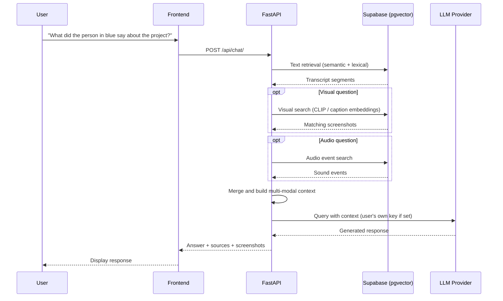
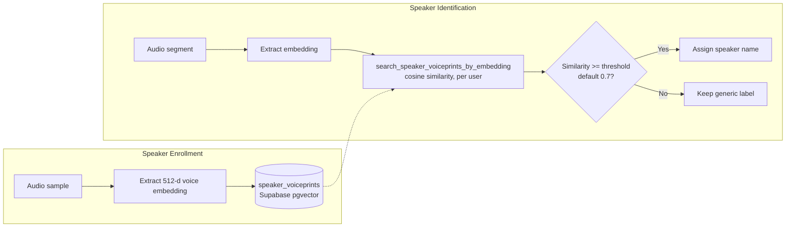

# Architecture

Detailed architecture documentation for AI-Subs. For resource names, secrets, scheduler jobs and quotas see [GCP_OPERATIONS.md](GCP_OPERATIONS.md); `backend/deploy.sh` is the source of truth for deployed resources.

## System Overview

The API runs on a cheap CPU Cloud Run service. Anything heavy (transcription, diarization, embeddings) runs in a separate GPU Cloud Run Job that the API triggers per upload.

## Background Job Flow

How a video is processed:

The worker exits with a `gpu_unavailable` failure if CUDA is missing, instead of silently falling back to CPU.

**Stale-job recovery.** Cloud Scheduler calls `POST /api/jobs/check-stale` every 5 minutes. Jobs in `processing` with no heartbeat for 90s, or `pending` for over 600s, are recovered through the same dispatch path as a manual retry.

## Multi-Modal RAG Chat

How chat builds context from the transcript, screenshots and audio events:

Retrieval lives in `backend/routers/chat.py` (`_retrieve_text_context`, `_retrieve_visual_context`, `_retrieve_audio_context`). Every search is scoped to the owner of the video.

## Speaker Recognition Flow

Diarization (pyannote, in the worker) labels speakers generically (`SPEAKER_00`, ...). Users can enroll a voice under a name, and later segments are matched against saved voiceprints:

Voiceprints are stored in Supabase rather than on local disk, because Cloud Run's filesystem is wiped on scale-to-zero (migration `011`). The code is `backend/speaker_recognition.py`, exposed by `routers/speaker.py`.

## Search Indexes

All vectors live in Supabase pgvector and are scoped to their owner (migrations `009`, `010`, `017`).

| Index | Content | Dimensions |
|-------|---------|-----------|
| Transcript | Segment embeddings (`BAAI/bge-small-en-v1.5`) | 384 |
| Image | Screenshot embeddings (CLIP `clip-ViT-B-32`) | CLIP |
| Caption | Vision-model captions, embedded per sentence | 384 |
| Audio events | PANNs events with timestamps | 384 |
| Face tags | Tagged faces and per-image face presence | 512 |
| Voiceprints | Enrolled speaker embeddings | 512 |

Schemas are in `backend/sql/` and `backend/sql/migrations/`.

## Local Mode

`LOCAL_MODE=true` swaps only the storage and dispatch layers: `LocalStorageService` replaces GCS, and `LocalDetachedJobDispatcher` runs `worker_main` as a local subprocess instead of a Cloud Run Job. Supabase is always real. `LOCAL_MODE` cannot be combined with `ENABLE_GCS_UPLOADS`.

## Deployment Stack

| Component | Service | Purpose |
|-----------|---------|---------|
| Frontend | Netlify | Static React build, deployed from main; calls the backend directly via `VITE_API_URL` |
| API | Cloud Run service `ai-subs-backend` (CPU) | FastAPI: auth, jobs, upload URLs, search, chat |
| Worker | Cloud Run Job `ai-subs-worker` (1x L4 GPU) | Transcription, diarization, embeddings |
| Database | Supabase Postgres | Jobs, users, transcripts, pgvector indexes |
| Realtime | Supabase Realtime | Live job progress in the browser |
| Storage | Google Cloud Storage | Videos and screenshots |
| Scheduling | Cloud Scheduler | `check-stale` (5 min), screenshot URL refresh (daily) |

## Data Flow

### Transcription Flow

1. **Upload**: File uploaded directly to GCS via signed URL
2. **Job Creation**: Supabase record created with `pending` status, worker job dispatched
3. **Processing**: The GPU worker reads the media from GCS and runs faster-whisper
4. **Diarization**: Chunked pyannote identifies speakers
5. **Storage**: Results and job status saved to Supabase
6. **Notification**: Realtime update sent to the frontend via Supabase

### Search Indexing Flow

All steps run in the worker as part of the job:

1. **Text**: Transcript segments embedded with Sentence Transformers → pgvector
2. **Visual**: Screenshots extracted → CLIP embeddings and vision captions (embedded per sentence) → pgvector
3. **Audio**: PANNs analyzes audio events → stored with timestamps
4. **Faces**: Face tags and presence are handled through `routers/face_tags.py`

### Chat Query Flow

1. **Query**: User question received
2. **Search**: Text retrieval, plus visual and audio retrieval when the question calls for them
3. **Context**: Results merged into one context block
4. **Generation**: The configured LLM provider generates a response
5. **Response**: Answer returned with source references
